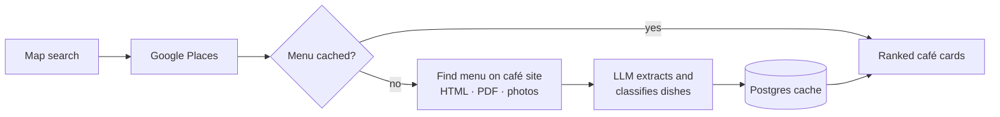

<div align="center">

# 🥞 Eggless

**Find a breakfast place for someone who does not eat eggs.**

Search a map for cafés and see each one's breakfast menu with the egg dishes already removed,<br>
ranked by how many egg-free dishes you can order as they are.


[](LICENSE)

</div>

---

Brunch menus are mostly eggs. Eggless reads the menus for you: it finds each café's menu on its own website, asks an LLM to sort every breakfast dish, and hides the ones where egg is the point.

> [!NOTE]
> This is a **preference filter, not an allergen tool**. It only reads what the menu says and cannot see egg hidden in batter, bread or sauces.

## ✨ Features

- 🗺️ **Map search** — "Near me" or "Search this area" finds breakfast cafés through Google Places.
- 🍳 **Egg-aware menus** — every dish goes into one of three groups:

  | Group | Example | Shown as |
  | --- | --- | --- |
  | Egg is the dish | omelette, eggs Benedict, shakshuka | hidden |
  | Egg is a removable part | full English, avocado toast with a poached egg | shown, tagged *ask without egg* |
  | No egg named | porridge, granola, pancakes, bacon sandwich | shown |

- 🏆 **Ranking** — cafés are ordered by how many dishes you can order as they are; pin colours on the map show the same.
- 🖼️ **Photos** — the café website's share image first, Google Places photos as a fallback, with a daily spending cap.
- 🔗 **Chain filter** — known chains get a badge and can be hidden with one tap; the choice is remembered.
- 📱 **Phone-first** — full-screen map with a pin preview, built for walking around.
- 🇷🇺 **Russian interface** — dish names are shown in Russian with the English original underneath.
- ⚡ **Read once** — results are cached by Google place ID, so a café is read once and is instant afterwards.

## ⚙️ How it works



1. **Search.** Google Places returns breakfast cafés in the visible area.
2. **Find the menu.** Google does not expose menus through its API, so the server looks for a menu page, PDF or menu photos on the café's own website. The fetcher blocks private addresses and caps download sizes.
3. **Extract.** An LLM returns the breakfast dishes in a schema-constrained response and puts each into one of the three groups. Region-only, catering and drinks items are filtered out.
4. **Rank and cache.** Option counts drive the ranking; the result is stored by place ID.

Full design: [docs/ARCHITECTURE.md](docs/ARCHITECTURE.md).

## 🧱 Stack

| Layer | Choice |
| --- | --- |
| App and hosting | Next.js (App Router) on Vercel |
| Map and search | Google Maps JavaScript API, Places API (New) |
| Menu extraction | Vercel AI SDK with a zod schema; model set by `LLM_MODEL` |
| Database | Neon Postgres, Drizzle ORM |
| Access | One secret link (`/?k=…`) stored in a cookie |
| Tests | Vitest, Testing Library, recorded café-site fixtures |

## 🚀 Getting started

**Requirements:** Node.js 20.9+, a Google Cloud project, an Anthropic API key and a Postgres database (Neon works out of the box).

```bash
git clone https://github.com/goroser/Eggless.git
cd Eggless
npm install
cp .env.example .env.local   # then fill it in, see below
npm run db:migrate
npm run dev
```

Open `http://localhost:3000/?k=<ACCESS_KEY>`.

<details>
<summary><b>Setting up the keys</b></summary>

1. **Google Cloud:** enable **Places API (New)** and **Maps JavaScript API**, then create:
   - a server key restricted to Places API (New) → `GOOGLE_PLACES_API_KEY`;
   - a browser key restricted by HTTP referrer to your domain and `localhost:3000`, and to the Maps JavaScript API → `NEXT_PUBLIC_GOOGLE_MAPS_API_KEY`;
   - a Map ID (Google Maps Platform → Map management, type JavaScript, vector) → `NEXT_PUBLIC_GOOGLE_MAP_ID`;
   - a daily quota on Places API (New) Text Search (for example 30 requests per day), so usage stops instead of billing.
2. **Anthropic:** an API key → `ANTHROPIC_API_KEY`.
3. **Database:** any Postgres URL → `DATABASE_URL`. On Vercel, `npx vercel integration add neon` writes it for you.
4. **Secrets:** `ACCESS_KEY` and `MENU_TOKEN_SECRET`, each from `openssl rand -base64 32`.
5. **Optional:** `PHOTO_DAILY_CAP` limits how many Google photos are served per day (default 100).

</details>

<details>
<summary><b>Deploying to Vercel</b></summary>

```bash
npx vercel link
bash scripts/push-env.sh      # copies .env.local to Vercel production without printing values
npx vercel deploy --prod
```

</details>

### Commands

| Command | What it does |
| --- | --- |
| `npm run dev` | local site |
| `npm test` | unit and integration tests (no network) |
| `npm run typecheck` | TypeScript check |
| `npm run smoke -- <url>` | live search and extraction against a running site |
| `npm run db:migrate` | apply migrations to `DATABASE_URL` |
| `npm run translate:cached` | backfill Russian dish names for menus cached before Phase 2 |
| `npm run spike` | the Phase 0 extraction experiment |

## 🗂️ Project layout

```
app/
  page.tsx                 map + ranked café cards
  api/search/route.ts      Places search, joined with cached menus
  api/menu/route.ts        find, extract and classify one café's menu
  api/photo/route.ts       Google photo proxy with a daily cap
proxy.ts                   secret-link gate for every page and API route
components/                EgglessApp, CafeMap, MapPreview, CafeCard, CafePhotos, ChainFilter
lib/
  places.ts, photos.ts     Google Places client and photo selection
  chains.ts                chain detection
  token.ts, access.ts      signed menu tokens, gate decision
  menu/                    safe fetcher, menu discovery, extraction, filtering, scoring
  db/                      Drizzle schema and menu cache
  handlers/                route logic, testable without Next
  client/                  menu queue and useCafes hook
  i18n/ru.ts               all interface text
scripts/                   spike, smoke run, fixture capture, translation backfill, env upload
docs/                      architecture, spike results, phase specs and plans
```

## 🛣️ Roadmap

- [x] **Phase 0 — spike.** Measure menu coverage and classification quality on about 20 cafés in Chiswick, London. Result: go ([docs/SPIKE.md](docs/SPIKE.md)).
- [x] **Phase 1 — MVP.** Search, "near me", extraction, caching, map and cards, private link. Live smoke run: 14/20 cafés usable.
- [x] **Phase 2 — Russian, photos, chains.** Russian interface and dish names, full-screen map with pin preview, café photos, chain filter.
- [ ] **Next.** "This is wrong" overrides, nightly menu refresh, PWA, better coverage of image-only menus, favourites and sharing.

## 📄 License

[MIT](LICENSE)
