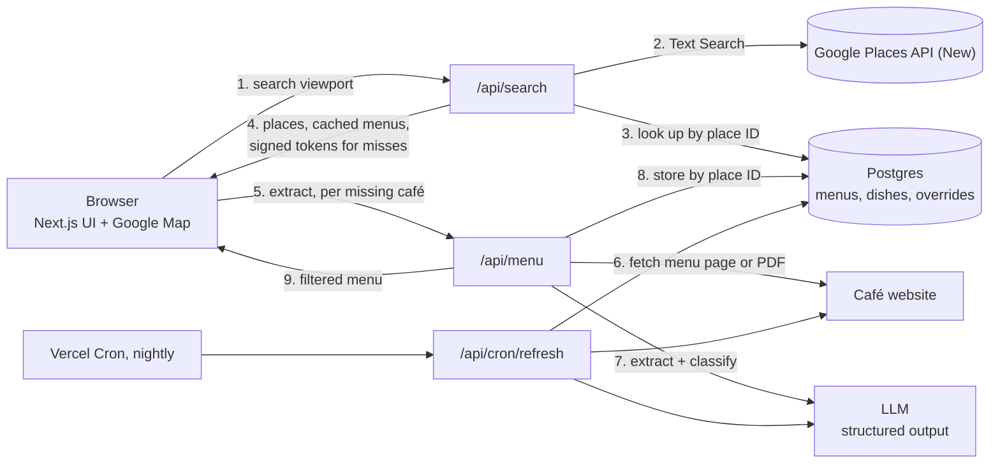

# Architecture

Status: design, no application code yet. Last updated 2026-10-02.

## 1. Goal

A web page where you search a map for cafés and immediately see each one's breakfast menu with the egg dishes taken out, ranked by how many real egg-free options it has.

The rule is a **preference, not an allergy**. Only dishes where egg is named or is the defining ingredient matter. Hidden egg (batter, brioche, mayo, hollandaise as a sauce on something else) is ignored. This keeps classification simple and cheap, and it means the app must never be presented as allergen-safe.

Non-goals for now: user accounts, other dietary filters, native apps, coverage outside the UK.

## 2. The core constraint

Google Places does not expose menus. The Places API (New) returns the café, its location, rating, website and flags such as `servesBreakfast`; the only menu-related field is `menuForChildren`. The structured menus visible in the Google Maps app are not available through the API.

So the menu comes from the café's own website, and an LLM extracts and classifies the dishes. Everything else in this design follows from that.

## 3. System overview



Request flow:

1. The user pans the map or taps "Search this area". The browser sends the viewport bounds to `/api/search`.
2. The server runs one Places Text Search for breakfast cafés inside those bounds (up to 20 results).
3. It looks up the returned place IDs in Postgres.
4. It responds with the live Google data for every place, the cached menu summary where one exists, and a short-lived signed token for each place that has no cached menu.
5. The browser renders all cards at once. For cards without a menu it calls `/api/menu` (three at a time) and fills them in as results arrive.
6. `/api/menu` verifies the token, finds the menu on the café's site, extracts and classifies the dishes, stores the result under the place ID and returns it.

Cached cafés appear instantly. A café seen for the first time takes roughly 5–20 seconds, once, for everyone.

## 4. Components

### 4.1 Frontend

- Next.js (App Router) on Vercel, Tailwind, mobile-first, since this will mostly be used on a phone while out.
- Google Maps JavaScript API through `@vis.gl/react-google-maps`. A Google map is used on purpose: Places results shown without one need separate Google logo attribution, and using Google's own map keeps the terms simple.
- Views: map with pins coloured by option count, and a ranked list of cards.
- Card: name, rating, open now, "5 egg-free options", the top three dishes, then expandable full menu. Egg dishes are collapsed under "12 egg dishes hidden" so the filter is visible and reversible.
- Each card links to the source menu and to Google Maps. The source link is how the user checks the extraction.
- Installable as a PWA so it sits on the home screen.

### 4.2 `/api/search`

- Input: viewport rectangle, or a centre point from "near me".
- Calls `places:searchText` with `textQuery: "breakfast cafe"`, `locationRestriction.rectangle`, `pageSize: 20`.
- Field mask: `places.id`, `places.displayName`, `places.location`, `places.googleMapsUri`, `places.primaryType`, `places.rating`, `places.userRatingCount`, `places.currentOpeningHours.openNow`, `places.websiteUri`, `places.servesBreakfast`.
- Joins the results with `menus` on place ID.
- For misses, issues `token = HMAC(placeId + websiteUri + expiry)`. The website URL travels to the browser and back inside the token, so the server neither stores Google data nor trusts a URL supplied by the client.
- Ranking: egg-free option count, then adaptable count, then rating. Cafés with unknown menus sort last but are still shown.

### 4.3 `/api/menu` (the extraction pipeline)

1. **Verify** the token and re-check the cache, so concurrent requests do not extract twice.
2. **Discover** the menu on the café's site:
   - Fetch the homepage with an 8 second timeout and a 2 MB cap.
   - Collect candidates: links whose text or href matches `menu|breakfast|brunch|food|eat|all-day`, linked PDFs, and schema.org `hasMenu` / `Menu` JSON-LD.
   - Score them (breakfast and brunch above generic menu, same-domain above external) and fetch the top three.
3. **Normalise** by content type:
   - HTML: strip to readable text.
   - PDF: pass the file to the model directly.
   - Image: pass to the model as vision input (phase 3).
   - If the HTML is nearly empty because the site renders client-side, retry through a rendering fetcher (Firecrawl or similar) behind the same `MenuFetcher` interface.
4. **Extract and classify** in one LLM call with a schema-constrained response (section 5).
5. **Apply overrides** from the `overrides` table, then compute the counts.
6. **Store** the menu and dishes under the place ID, with the source URL, a content hash, the model and the prompt version.

Outcomes are stored too, so a failed café is not retried on every search: `ok`, `no_website`, `no_menu_found`, `no_breakfast`, `fetch_failed`. Successful menus are kept for 30 days and failures for 7.

Guard rails: only `http(s)` URLs, no private or loopback addresses, no following redirects off to delivery platforms. Delivery sites (Deliveroo, Uber Eats) are not scraped.

### 4.4 Nightly refresh

A Vercel Cron job runs once a day, which is the Hobby plan limit. It picks menus past their expiry, re-fetches the stored source URL and compares the content hash. The LLM is called only when the page actually changed, so refresh costs close to nothing.

### 4.5 Storage

Neon Postgres through the Vercel Marketplace, with Drizzle as the query layer. Vercel KV and Vercel Postgres no longer exist as first-party products; storage is provisioned through Marketplace providers (`vercel install neon`).

## 5. Classification

One call per menu. The model returns breakfast and brunch dishes only, each with:

| Field | Meaning |
| --- | --- |
| `name`, `description`, `price`, `section` | Copied from the menu, not paraphrased |
| `eggStatus` | `egg_main`, `egg_component` or `no_egg` |
| `eggEvidence` | The words on the menu that triggered the status |
| `substantial` | `false` for toast, a pastry, a side or a bowl of fruit |

The three statuses:

- **`egg_main`**: egg is the dish. Omelette, eggs Benedict, shakshuka, scrambled eggs on toast, frittata. Hidden by default.
- **`egg_component`**: egg is a named, removable part. Full English, avocado toast with a poached egg. Shown, tagged "ask without egg".
- **`no_egg`**: no egg named. Porridge, granola, pancakes, bacon sandwich. Shown.

A café's headline number counts `no_egg` dishes that are `substantial`. Without the `substantial` flag every café looks fine because every café sells toast.

Because the judgement is about what the menu says rather than what the kitchen does, the model reads only the dish name and description. That is a simple task, so a small model is enough.

**Overrides.** A table of dish-name patterns with a forced status handles personal exceptions and model mistakes, per café or globally. A "this is wrong" button on each dish writes to it.

## 6. Data model

Only the Google place ID is stored from Google. Everything else in the database is our own data, derived from café websites.

```
menus
  place_id        text primary key      -- Google place ID
  status          text                  -- ok | no_website | no_menu_found | no_breakfast | fetch_failed
  source_url      text                  -- the menu page or file we extracted from
  source_type     text                  -- html | pdf | image
  content_hash    text
  served_until    text                  -- "until 11:30", if the menu says
  options_count   int                   -- no_egg and substantial
  adaptable_count int                   -- egg_component
  egg_count       int                   -- egg_main
  model           text
  prompt_version  int
  extracted_at    timestamptz
  expires_at      timestamptz

dishes
  id              bigserial primary key
  place_id        text references menus
  position        int
  section         text
  name            text
  description     text
  price           text
  egg_status      text                  -- egg_main | egg_component | no_egg
  egg_evidence    text
  substantial     boolean

overrides
  id              bigserial primary key
  place_id        text                  -- null means global
  dish_pattern    text
  egg_status      text
  note            text
  created_at      timestamptz
```

## 7. Key decisions

| # | Decision | Why | Alternative rejected |
| --- | --- | --- | --- |
| 1 | Menus come from café websites, read by an LLM | The only source that is both available and within terms | Scraping the Google Maps menu tab: against Google's terms and brittle |
| 2 | Store only the place ID from Google | Places policy exempts the place ID from caching limits and nothing else; every search therefore makes one live Places call | Caching names, ratings and coordinates: cheaper per search but not permitted |
| 3 | Lazy extraction on first view, plus optional seeding | No crawl infrastructure, and cost scales with real use | Crawling all of London up front: most of it would never be viewed |
| 4 | Signed token carries the website URL between the two API calls | Stateless, and keeps Google data out of the database | A second Place Details call per café: doubles Places usage |
| 5 | Three statuses instead of two | Hiding every dish that includes an egg would remove half of most brunch menus | Binary egg / no egg |
| 6 | Postgres over a key-value store | Overrides, per-dish feedback and re-ranking need queries | Upstash Redis: simpler, fine if overrides are dropped |
| 7 | Vercel AI SDK with a zod schema, model set by env var | Provider can be swapped without touching the pipeline | Calling one provider's SDK directly |
| 8 | Public page protected by quotas and rate limits, no login | It is a link to open on a phone; a login is friction | Auth: can be added later if the quota gets abused |

## 8. Cost and limits

Figures from Google's pricing page on 2026-10-02; check before relying on them.

| Item | Free allowance | Beyond that |
| --- | --- | --- |
| Places Text Search, Enterprise + Atmosphere tier | 1,000 requests a month | $40 per 1,000 |
| Maps JavaScript dynamic map loads | 10,000 a month | $7 per 1,000 |
| LLM extraction | none | roughly a penny per menu with a small model, paid once per café per menu change |
| Vercel, Neon | Hobby and free tiers should be enough | |

The field mask decides the Places tier. `websiteUri` and `rating` put a request in Enterprise; `servesBreakfast` puts it in Enterprise + Atmosphere. Both have the same 1,000 free requests, so the breakfast flag costs nothing extra until the allowance runs out.

1,000 searches a month is about 33 a day, plenty for personal use. To make an accidental bill impossible:

- Set a daily quota on the Places API in Google Cloud (for example 30 requests a day).
- Restrict the browser key by HTTP referrer to the domain, and the server key to the Places API only.
- Rate-limit `/api/search` and `/api/menu` per IP.
- Debounce map movement; search only on an explicit "Search this area" tap.

## 9. Risks

| Risk | Effect | Mitigation |
| --- | --- | --- |
| Many cafés have no parsable menu (Instagram only, image menus, no site) | Thin results | Measure in phase 0 before building UI. Show these as "menu unknown", never hide them. Image and PDF support in phase 3 |
| The model invents or misreads dishes | Wrong recommendation | Names copied verbatim, `eggEvidence` stored, source link on every card, overrides table |
| Stale menus | Dish no longer served | 30-day expiry, hash-based refresh, "menu read on" date on the card |
| Seasonal or all-day menus mixed with breakfast | Lunch dishes counted as breakfast | Model returns breakfast and brunch sections only, plus `served_until` |
| Sites blocking automated fetches | Missing menus | Honest user agent, one fetch per café per month, rendering fallback |
| Someone finds the URL and burns the quota | Service stops for the day | Hard quotas mean it stops rather than bills |
| Google policy on storing the source URL | Compliance grey area | The stored URL is the menu page found by our own crawl, not the Places field; revisit if the project goes beyond personal use |

## 10. Delivery plan

**Phase 0, spike (half a day).** A script, no UI. Take about 20 breakfast places around Chiswick, run discovery and extraction, print the results. Success means a usable menu for at least 60% of them and classifications that look right on inspection. If coverage is poor, bring image and PDF handling forward before building anything else.

**Phase 1, MVP.** Search route, extraction route, Postgres, map and cards, quotas. Deployed to the domain.

**Phase 2.** Ranking polish, overrides and the "this is wrong" button, nightly refresh, PWA install, "near me".

**Phase 3.** Image menus, rendering fallback for client-side sites, favourites, sharing a café.

## 11. Open questions

1. Which dishes count as egg dishes when egg is not in the name but everyone knows it is there: French toast, quiche, carbonara, kedgeree? Default is "shown", per the preference rule; the overrides table can flip any of them.
2. Should `egg_component` dishes count towards a café's headline number, or stay as a secondary count?
3. Breakfast only, or brunch and all-day menus as well?
4. Is a public URL acceptable, or should the page sit behind a simple shared link?
5. Seeding: is it worth pre-extracting the Chiswick area so the first use is instant?
